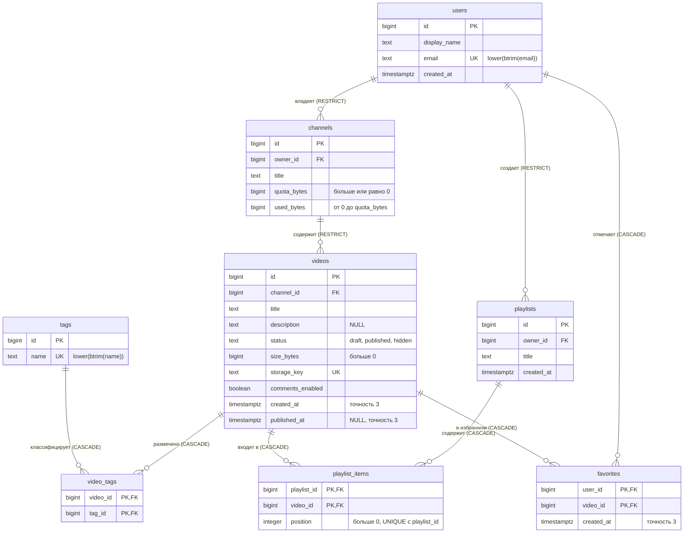

# Модель данных

## ER-диаграмма

Исходник диаграммы — блок Mermaid ниже: его можно править как текст, а GitHub и большинство редакторов Markdown рисуют его как картинку. Старый вариант в PDF лежит в `Documents/Diagrame E-R.pdf`. Он не учитывает миграцию `170003`: в нем у `playlists.owner_id` стоит RESTRICT, а в первой миграции было CASCADE.

Связи 1:N: пользователь → каналы, пользователь → плейлисты, канал → видео. Связи M:N: видео ↔ теги (через `video_tags`), пользователь ↔ видео (через `favorites`), плейлист ↔ видео (через `playlist_items`). У каждой связи со стороны «многих» участие необязательно: канал может быть без видео, видео без тегов, плейлист пустой.

## Словарь данных

Общие решения:
- **Идентификаторы.** Везде `bigint GENERATED ALWAYS AS IDENTITY`; задать id вручную в обычном INSERT нельзя.
- **Байты.** Хранятся в `bigint`.
- **Моменты времени.** Хранятся в `timestamptz`.
- **JSON.** Любой `bigint` передается десятичной строкой (`"9007199254740993"`): JavaScript `number` теряет точность после 2^53. Даты передаются в ISO 8601 с часовым поясом (`2025-01-05T10:00:00.000Z`).

Актуальный словарь — эта таблица. Файл `Documents/data dictionary.xlsx` описывает первую версию схемы.

### users

| Столбец | Смысл | Тип | NULL | По умолчанию | Ограничения | Пример |
|---|---|---|---|---|---|---|
| id | Идентификатор пользователя | bigint identity | NOT NULL | генерируется | `pk_users` | `1` |
| display_name | Отображаемое имя | text | NOT NULL | — | не пустое после trim | `Usuario 1` |
| email | Адрес почты | text | NOT NULL | — | уникален после `lower(btrim())` (`uq_users_email_normalized`), не пустой | `user1@example.com` |
| created_at | Момент регистрации | timestamptz | NOT NULL | `now()` | — | `2026-11-01T10:00:00Z` |

### channels

| Столбец | Смысл | Тип | NULL | По умолчанию | Ограничения | Пример |
|---|---|---|---|---|---|---|
| id | Идентификатор канала | bigint identity | NOT NULL | генерируется | `pk_channels` | `1` |
| owner_id | Владелец канала | bigint | NOT NULL | — | `fk_channels_owner` → users, ON DELETE RESTRICT | `1` |
| title | Название | text | NOT NULL | — | не пустое | `Canal de Ana` |
| quota_bytes | Квота канала | bigint | NOT NULL | — | `>= 0` | `104857600` |
| used_bytes | Занято видео канала (сохраненный итог) | bigint | NOT NULL | `0` | `0 <= used_bytes <= quota_bytes` | `52800` |

### videos

| Столбец | Смысл | Тип | NULL | По умолчанию | Ограничения | Пример |
|---|---|---|---|---|---|---|
| id | Идентификатор видео | bigint identity | NOT NULL | генерируется | `pk_videos` | `2` |
| channel_id | Канал | bigint | NOT NULL | — | `fk_videos_channel` → channels, RESTRICT | `1` |
| title | Название | text | NOT NULL | — | не пустое | `Утренняя зарядка` |
| description | Описание | text | NULL — описания может не быть | — | — | `Комплекс на 15 минут` |
| status | Статус | text | NOT NULL | `'draft'` | `IN ('draft','published','hidden')` | `published` |
| size_bytes | Зарезервированный размер | bigint | NOT NULL | — | `> 0`, после создания не меняется | `15000000` |
| storage_key | Условный ключ объекта в хранилище | text | NOT NULL | — | уникален | `videos/1/5f0c…` |
| comments_enabled | Разрешены ли комментарии | boolean | NOT NULL | `true` | — | `true` |
| created_at | Момент создания | timestamptz(3) | NOT NULL | `now()` | — | `2026-11-01T13:40:43.067Z` |
| published_at | Момент первой публикации | timestamptz(3) | NULL — у черновика ее нет | — | обязательна при `published`, запрещена при `draft` | `2025-01-05T10:00:00.000Z` |

### tags, video_tags

| Столбец | Смысл | Тип | NULL | По умолчанию | Ограничения | Пример |
|---|---|---|---|---|---|---|
| tags.id | Идентификатор тега | bigint identity | NOT NULL | генерируется | `pk_tags` | `1` |
| tags.name | Имя тега | text | NOT NULL | — | уникально после `lower(btrim())`, не пустое | `cardio` |
| video_tags.video_id | Видео | bigint | NOT NULL | — | часть `pk_video_tags`; FK → videos, CASCADE | `2` |
| video_tags.tag_id | Тег | bigint | NOT NULL | — | часть `pk_video_tags`; FK → tags, CASCADE | `1` |

### playlists, playlist_items

| Столбец | Смысл | Тип | NULL | По умолчанию | Ограничения | Пример |
|---|---|---|---|---|---|---|
| playlists.id | Идентификатор плейлиста | bigint identity | NOT NULL | генерируется | `pk_playlists` | `1` |
| playlists.owner_id | Владелец | bigint | NOT NULL | — | `fk_playlists_owner` → users, RESTRICT | `1` |
| playlists.title | Название | text | NOT NULL | — | не пустое | `My Cardio Favorites` |
| playlists.created_at | Момент создания | timestamptz | NOT NULL | `now()` | — | `2026-11-01T10:00:00Z` |
| playlist_items.playlist_id | Плейлист | bigint | NOT NULL | — | часть `pk_playlist_items`; FK, CASCADE | `1` |
| playlist_items.video_id | Видео | bigint | NOT NULL | — | часть `pk_playlist_items`; FK, CASCADE | `2` |
| playlist_items.position | Место видео в этом плейлисте | integer | NOT NULL | — | `> 0`; `UNIQUE (playlist_id, position)` | `1` |

### favorites

| Столбец | Смысл | Тип | NULL | По умолчанию | Ограничения | Пример |
|---|---|---|---|---|---|---|
| user_id | Пользователь | bigint | NOT NULL | — | часть `pk_favorites`; FK → users, CASCADE | `1` |
| video_id | Видео | bigint | NOT NULL | — | часть `pk_favorites`; FK → videos, CASCADE | `2` |
| created_at | Момент добавления | timestamptz(3) | NOT NULL | `now()` | — | `2025-02-01T12:00:01.000Z` |

## Нормализация

### Исходная таблица

Начнем с плоской таблицы, где все хранится вместе, а теги одной строкой:

| video_id | video_title | channel_id | channel_title | owner_id | owner_name | tags |
|---|---|---|---|---|---|---|
| 1 | V1 - Draft without tags | 1 | Canal de Ana | 1 | Usuario 1 | |
| 2 | V2 - Published with tags | 1 | Canal de Ana | 1 | Usuario 1 | cardio, yoga |
| 3 | V3 - Published same date | 2 | Canal de Ana 2 | 1 | Usuario 1 | strength |
| 5 | V5 - Published same date | 3 | Fitness Total | 2 | Usuario 2 | stretching, hiit |
| 7 | V7 - Published | 4 | Yoga & Relax | 3 | Usuario 3 | meditation |
| 9 | V9 - Published | 5 | Cardio Extremo | 4 | Usuario 4 | health |
| 10 | V10 - Draft | 5 | Cardio Extremo | 4 | Usuario 4 | beginners, advanced |

### Аномалии

- **Обновление.** Если «Usuario 1» сменит имя, придется править строки 1, 2 и 3. Если забыть одну, у одного автора окажется два имени. Переименование канала 1 — то же самое, только в строках 1 и 2.
- **Вставка.** Канал 8 «Canal Vacío» без видео в эту таблицу не записать: `video_id` — ключ, и строка без видео не имеет смысла. Пользователя 6, у которого еще нет каналов, тоже. Новый тег, пока его не поставили ни на одно видео, хранить негде.
- **Удаление.** Если удалить видео 7, вместе с ним пропадет единственное упоминание канала «Yoga & Relax», пользователя 3 и тега meditation.
- **Неатомарное значение.** `tags = 'cardio, yoga'` — список в одной ячейке. Найти все видео с тегом cardio можно только разбором строки (`LIKE '%cardio%'`, который заодно найдет `cardio-advanced`). Переименовать тег нужно во всех строках сразу. Повтор тега в одной ячейке ничем не запрещен.

### Зависимости

В исходной таблице действуют функциональные зависимости:
- `video_id → video_title, channel_id`
- `channel_id → channel_title, owner_id`
- `owner_id → owner_name`

Неключевые `channel_title`, `owner_id` и `owner_name` зависят от ключа `video_id` не напрямую, а через `channel_id` (и через `owner_id`). Это транзитивные зависимости, из-за них и возникают аномалии обновления.

### Приведение к 3НФ

1. **1НФ.** Список тегов разносим по строкам: пара (видео, тег) становится отдельной строкой. Ключом такой «развернутой» таблицы становится (`video_id`, `tag`). `video_title` и данные канала при этом зависят только от части ключа (`video_id`). Это частичная зависимость, нарушение 2НФ.
2. **2НФ.** Выносим то, что зависит только от `video_id`, в `videos(id, title, channel_id, …)`. Связь хранится отдельно в `video_tags(video_id, tag_id)`, где нет неключевых атрибутов вообще. Имя тега определяется самим тегом, поэтому оно уходит в `tags(id, name)`.
3. **3НФ.** Убираем транзитивные зависимости: данные канала переходят в `channels(id, title, owner_id)`, данные пользователя — в `users(id, display_name, …)`. Теперь каждый неключевой атрибут зависит от ключа своей таблицы, от всего ключа и ни от чего, кроме ключа.

Итог — `users`, `channels`, `videos`, `tags`, `video_tags`. Имя владельца хранится в одной строке `users`, и переименование — это одна команда: `UPDATE users SET display_name = 'Ana' WHERE id = 1`. Все видео канала увидят новое имя через JOIN. Пустой канал и тег без видео хранятся сами по себе. Удаление видео трогает только `videos` и связи.

Атомарность понимаем практически: для операций этой работы название и описание неделимы (по частям их не ищут, кроме поиска подстроки в названии). Список тегов неделим быть не может, потому что по отдельным тегам фильтруют и считают.

В таблицах связей атрибуты описывают саму связь. `playlist_items.position` — место видео в конкретном плейлисте; одно видео в двух плейлистах стоит на разных местах. Поэтому позиция зависит от пары (`playlist_id`, `video_id`), а не от видео. `favorites.created_at` — момент, когда этот пользователь отметил это видео. Частичных зависимостей от составного ключа в этих таблицах нет.

### Осознанная денормализация: used_bytes

`channels.used_bytes` выводится из других данных: его источник истины — `SUM(videos.size_bytes)` по каналу, включая draft и hidden. Мы храним эту сумму, чтобы резерв квоты был одним условным `UPDATE` одной строки с ее блокировкой, без пересчета суммы. Обычный CHECK видит только свою строку и не сверит сумму с другой таблицей, поэтому согласованность держится на трех вещах:
- транзакционном алгоритме создания видео;
- отсутствии в API путей, которые меняют размер, удаляют видео или квоту;
- отдельной проверке — запросе 10 (`difference = 0` у всех каналов) и сверке после каждого seed.
